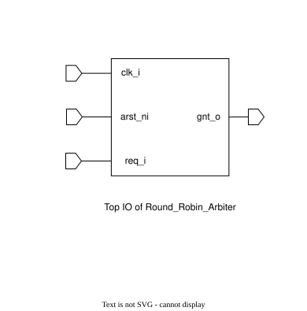
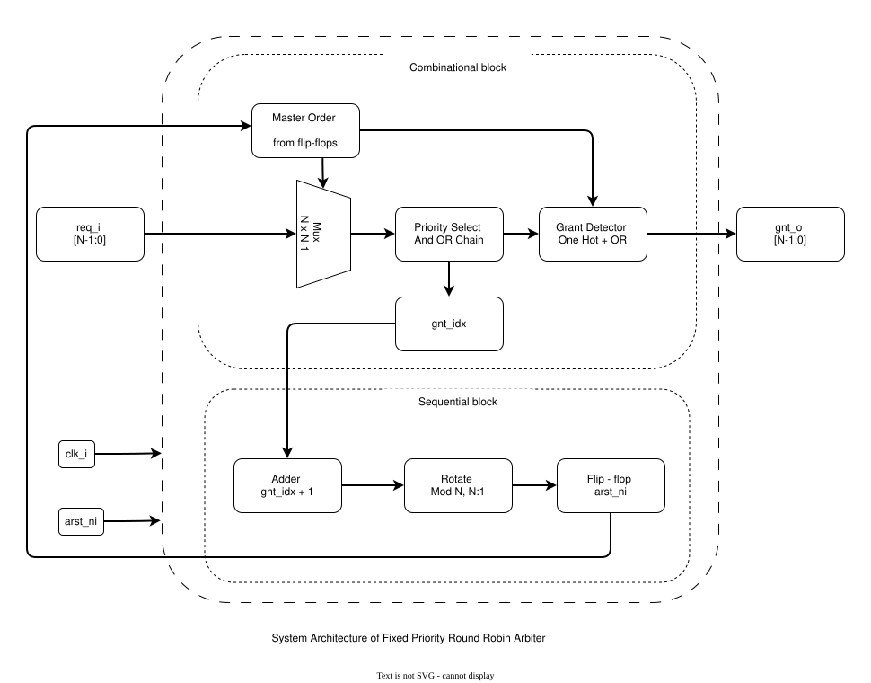

# Round Robin Arbiter 

### Author Name: Siam Bhai's Team
### Module Name: round_robin_arbiter

## Overview


The `round_robin_arbiter` module implements a parameterized Round Robin Arbiter in SystemVerilog. It selects one requester from multiple active requests and generates a one-hot grant signal.

Unlike a fixed-priority arbiter, the priority rotates after each grant. This provides fair access to a shared resource and prevents a continuously requesting master from permanently dominating arbitration.

## Top IO



## Ports

| Name | Direction | Type | Width | Description |
|---|---|---|---|---|
| clk_i | input | logic | 1 | Clock input. Pointer updates on the rising edge. |
| arst_ni | input | logic | 1 | Active-low asynchronous reset input. Resets the priority pointer to zero. |
| req_i | input | logic | N | Request vector. Each bit represents a request from one master. |
| gnt_o | output | logic | N | One-hot grant vector. At most one requester is granted at a time. |


## Parameters

| Name | Type | Default | Description |
|---|---|---:|---|
| N | int | 8 | Number of requesters (masters) connected to the arbiter |
| PTR_W | int | 3 | Pointer width, calculated as `max(1, $clog2(N))` |


## Block Diagram



## Key Features

- **Parameterized Requesters:** Supports `N` requesters through the `N` parameter.
- **Priority Order Table:** Stores the current priority sequence as `master_order[0:N-1]`. Each entry holds a master index, and position 0 is the highest priority.
- **Fixed Scan Start:** The scan always begins at position 0 of the priority order table. The scan start never moves; only the contents of the table are rotated.
- **First-Request Selection:** Scans the table in order and grants the first master whose request is active, using a `found` flag.
- **One-Hot Grant Output:** Produces `gnt_o` as either a one-hot grant vector or all zeros when no request is active.
- **Grant Index Tracking:** Reports `gnt_idx`, the position in the priority order table at which the granted master was found. This is the table position, not the master index.
- **Grant-Triggered Rotation:** When a grant occurs (`found` asserted), the table is rotated so that the entries after the granted position move to the front and the granted master moves to the lowest priority (last position).
- **Hold When Idle:** If no request is active, the priority order table is unchanged.
- **Modular Structure:** Split into a combinational `grant_generator`, a sequential `priority_generator`, and the top module `round_robin_arbiter`.
- **Asynchronous Active-Low Reset:** Resets the priority order table to its default order (`0, 1, ..., N-1`) when `arst_ni` is asserted.

## Working Principle

1. `master_order[0]` holds the master with the highest priority and `master_order[N-1]` holds the master with the lowest priority. After reset, the order is `0, 1, ..., N-1`.
2. The `grant_generator` scans table positions `i = 0 ... N-1` in increasing order and checks `req_i[master_order[i]]`.
3. The first active request found receives the grant. Its bit in `gnt_o` is set, `found` is asserted, and `gnt_idx` is set to the table position `i`. Later positions are ignored.
4. If no request is active, `gnt_o` remains zero, `found` remains low, and the priority order table does not change.
5. When `found` is high, the `priority_generator` rotates the table on the next rising edge of `clk_i`:
   `master_order[i] <= master_order[(i + gnt_idx + 1) % N]`
6. After the rotation, the master that followed the granted master is at position 0, and the granted master is at position `N-1`.


### Combinational Logic

| Component | Function |
|---|---|
| Index Generator | Calculates the requester index to examine using the current pointer and loop index. |
| Wraparound Logic | Keeps the calculated index within the valid requester range. |
| Priority Selection Logic | Searches for the first active request according to the current priority. |
| Grant Generation | Generates the one-hot grant output. |

### Sequential Logic

| Component | Function |
|---|---|
| Grant Detection | Detects whether any requester has been granted. |
| Winner Detection | Identifies the requester that received the grant. |
| Next-Priority Generator | Calculates the next priority pointer and handles wraparound. |
| Priority Pointer Register | Stores the next arbitration starting position. |

The priority pointer is updated on the rising edge of `clk_i`. Asserting `arst_ni` low asynchronously resets the pointer to zero.

## Simulation and Execution

The design can be compiled and simulated using the project's `Makefile`.


```bash
make simulate TOP=round_robin_arbiter
```

The `simulate` target in the `Makefile` should compile the RTL and testbench, run the simulation, and display or generate the simulation results. If the project defines additional options or variables, check the `Makefile` for the supported arguments and use them with the command. For example, a parameter override can be passed as a Make variable only if the `Makefile` is configured to accept it.


