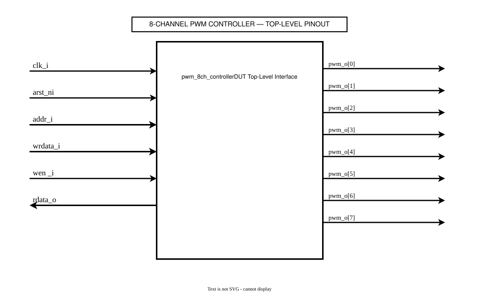
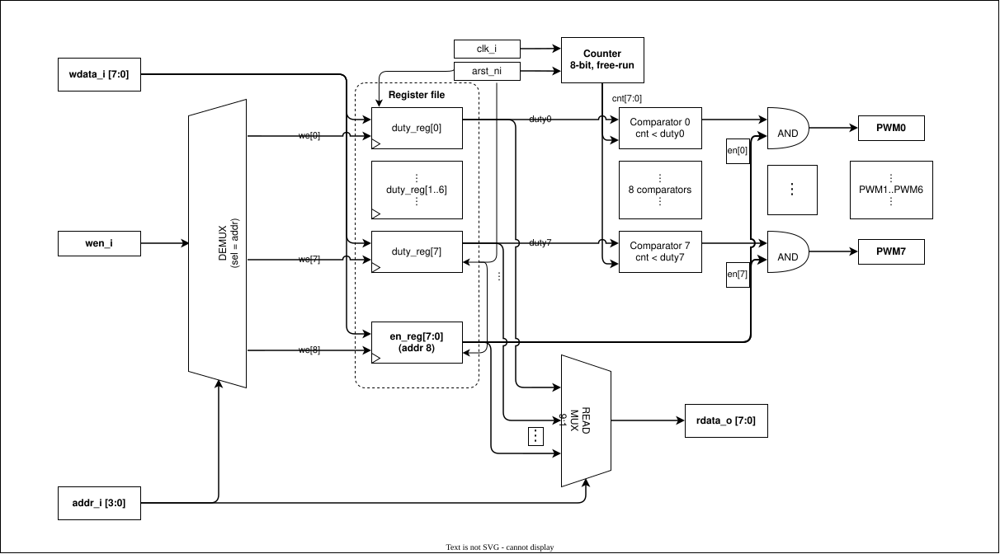

# PWM Controller Design

# Architectural & Functional Specification Proposal

## Author: **The Team led by Adnan Sami Anirban**
***
## Module Name: `pwm_controller `

## Overview
The PWM (Pulse Width Modulation) Controller is a digital hardware module designed to generate eight independent PWM output signals with programmable duty cycles. It uses a shared 8-bit free-running counter and eight comparators to determine the pulse width of each output channel. Each channel has an individual 8-bit duty-cycle register, allowing its duty cycle to be configured independently. An enable register controls the activation of each PWM channel. The controller also includes a register file with address-based write decoding and read-data selection to support configuration and status access.

The architecture provides a simple and efficient approach to generating multiple PWM signals using a shared counter and dedicated comparison logic for each channel.


## Key Features

- 8-channel PWM generation

- 8-bit programmable duty-cycle resolution

- Eight independent duty-cycle registers

- One shared 8-bit free-running counter

- Eight independent counter-to-duty-cycle comparators

- 8-bit PWM channel enable register

- Address-based register selection

- DEMUX-based register write selection

- 9:1 register read multiplexer

- Common clock and active-low asynchronous reset interface

- No dedicated read-enable signal


## Parameter Table

The parameter table describes the configurable design parameters.


| Parameter | Default Value | Description |
|---|---:|---|
| `NUM_CHANNELS` | 8 |  Number of independent PWM output channels |
| `DATA_WIDTH`   | 8 |  Width of the register data bus (`wdata_i`, `rdata_o`) |
| `RESOLUTION`| 8 |  Width of the free-running counter and of each duty-cycle register (PWM period = 2^RESOLUTION clocks) |
| `ADDR_WIDTH`   | 4 |  Width of the register address |


## Top-Level Ports

The top-level signals are grouped in the SystemVerilog interface `pwm_if`
(modport `DUT`).

| Port | Type | Description |
|---|---|---|
| `vif` | `pwm_if.DUT` | Interface containing all signals listed below |


## Pin Description Table

The pin table describes all top-level input and output signals.

| Pin Name	| Direction |  Width |	Description |
| --- | --- | ---: | --- |
| clk_i	    | Input | 1	| System clock input |
| arst_ni	| Input	| 1	| Active-low asynchronous reset |
| addr_i	| Input	| ADDR_WIDTH (default 4)	| Register address input |
| wdata_i	| Input	| DATA_WIDTH (default 8)	| Register write-data input |
| wen_i	    | Input	| 1	| Register write-enable input |
| rdata_o	| Output| 8	| Register read-data output |
| pwm_o	    | Output| 8	| Eight independently controlled PWM output signals |





*****************
*****************

## Microarchitecture
*****************



The architecture consists of the following major blocks:

1. Register File
2. Write DEMUX
3. Read MUX (9:1)
4. PWM Counter (8-bit)
5. PWM Comparators (8 channels)
6. Output Enable Logic (AND gates)


### Global Signals

| Name | Direction | Width | Description |
|---|---|---:|---|
| `clk_i` | input | 1 | System clock for the register file and PWM counter |
| `arst_ni` | input | 1 | Asynchronous reset, active-low |

### Register Interface

| Name | Direction | Width | Description |
|---|---|---:|---|
| `addr_i` | input | 4 | Register address selection |
| `wdata_i` | input | 8 | Register write-data input |
| `wen_i` | input | 1 | Enables register write operation |
| `rdata_o` | output | 8 | Selected register read-data output |

**Note:** There is no `read_enable` input. The read MUX selects register data based on `addr_i`.

### PWM Output Interface

| Name | Direction | Width | Description |
|---|---|---:|---|
| `PWM0` | output | 1 | PWM channel 0 output |
| `PWM1` | output | 1 | PWM channel 1 output |
| `PWM2` | output | 1 | PWM channel 2 output |
| `PWM3` | output | 1 | PWM channel 3 output |
| `PWM4` | output | 1 | PWM channel 4 output |
| `PWM5` | output | 1 | PWM channel 5 output |
| `PWM6` | output | 1 | PWM channel 6 output |
| `PWM7` | output | 1 | PWM channel 7 output |

## Internal Register Map

The PWM controller contains eight duty-cycle registers and one enable register.

| Address | Register Name | Width | Access | Description |
|---|---|---:|---|---|
| `0x0` | `duty_reg[0]` | 8 | RW | PWM channel 0 duty-cycle value |
| `0x1` | `duty_reg[1]` | 8 | RW | PWM channel 1 duty-cycle value |
| `0x2` | `duty_reg[2]` | 8 | RW | PWM channel 2 duty-cycle value |
| `0x3` | `duty_reg[3]` | 8 | RW | PWM channel 3 duty-cycle value |
| `0x4` | `duty_reg[4]` | 8 | RW | PWM channel 4 duty-cycle value |
| `0x5` | `duty_reg[5]` | 8 | RW | PWM channel 5 duty-cycle value |
| `0x6` | `duty_reg[6]` | 8 | RW | PWM channel 6 duty-cycle value |
| `0x7` | `duty_reg[7]` | 8 | RW | PWM channel 7 duty-cycle value |
| `0x8` | `en_reg` | 8 | RW | Individual PWM channel enable control |

### Register Description

**Duty-Cycle Registers**

Each duty-cycle register stores an 8-bit value that determines the output duty cycle of its corresponding PWM channel.

- `duty_reg[0]` controls `PWM0`.
- `duty_reg[1]` controls `PWM1`.
- `duty_reg[2]` controls `PWM2`.
- `duty_reg[3]` controls `PWM3`.
- `duty_reg[4]` controls `PWM4`.
- `duty_reg[5]` controls `PWM5`.
- `duty_reg[6]` controls `PWM6`.
- `duty_reg[7]` controls `PWM7`.

**Enable Register**

The `en_reg[7:0]` register independently enables or disables the eight PWM channels.

| Bit | Description |
|---|---|
| `en_reg[0]` | Enables/disables PWM channel 0 |
| `en_reg[1]` | Enables/disables PWM channel 1 |
| `en_reg[2]` | Enables/disables PWM channel 2 |
| `en_reg[3]` | Enables/disables PWM channel 3 |
| `en_reg[4]` | Enables/disables PWM channel 4 |
| `en_reg[5]` | Enables/disables PWM channel 5 |
| `en_reg[6]` | Enables/disables PWM channel 6 |
| `en_reg[7]` | Enables/disables PWM channel 7 |

When an enable bit is LOW, its corresponding PWM output is forced LOW by the output gating logic.

## Internal Architecture

### 1. Register File

The register file stores the programmable duty-cycle values and channel enable configuration.

It consists of:

- Eight 8-bit duty-cycle registers.
- One 8-bit enable register.

The register file receives:

- `wdata_i[7:0]` as the write-data input.
- `addr_i[3:0]` as the register address.
- `wen_i` as the write-enable control.
- `clk_i` as the register clock.
- `arst_ni` as the active-low asynchronous reset.

The register file provides the stored values to the PWM generation logic and the read MUX.

### 2. Write DEMUX

The write DEMUX selects the destination register based on `addr_i`.

The DEMUX receives the register address and generates individual register write-enable signals.

The write-enable signals are gated by `wen_i`.

The generated write-enable signals are:

- `we[0]` through `we[7]` for the eight duty-cycle registers.
- `we[8]` for the enable register.

The write operation is performed when `wen_i` is HIGH and the corresponding register is selected.


The selected register captures `wdata_i` on the active clock edge.

Only the addressed register is updated during a write operation.

### 3. Read MUX (9:1)

The read MUX selects one of the nine internal register values and provides the selected value through `rdata_o`.

The nine MUX inputs consist of:

- Eight duty-cycle register outputs.
- One enable register output.

The address input `addr_i` controls the MUX selection.

The read operation is combinational and does not require a separate read-enable signal.

The address selection is:

| Address | Selected MUX Input |
|---|---|
| `0x0` | `duty_reg[0]` |
| `0x1` | `duty_reg[1]` |
| `0x2` | `duty_reg[2]` |
| `0x3` | `duty_reg[3]` |
| `0x4` | `duty_reg[4]` |
| `0x5` | `duty_reg[5]` |
| `0x6` | `duty_reg[6]` |
| `0x7` | `duty_reg[7]` |
| `0x8` | `en_reg` |

The selected register data is available at `rdata_o`.

Addresses `0x9` through `0xF` are outside the implemented register map. Their read behavior must be defined in the RTL implementation.

### 4. PWM Counter (8-bit)

The PWM controller uses one shared 8-bit free-running counter.

The counter increments on each active clock edge.

Its counting range is:

```text
0 → 1 → 2 → ... → 254 → 255 → 0
```

After reaching 255, the counter wraps around to zero and repeats the counting sequence.

The counter output is distributed to all eight PWM comparators.

The PWM period is determined by the counter width and the system clock frequency.


### 5. PWM Comparators

The architecture contains eight independent comparators.

Each comparator compares the shared 8-bit counter value with its corresponding duty-cycle register.

The comparison conditions are:

```systemverilog
Comparator 0: cnt < duty_reg[0]
Comparator 1: cnt < duty_reg[1]
Comparator 2: cnt < duty_reg[2]
Comparator 3: cnt < duty_reg[3]
Comparator 4: cnt < duty_reg[4]
Comparator 5: cnt < duty_reg[5]
Comparator 6: cnt < duty_reg[6]
Comparator 7: cnt < duty_reg[7]
```

When the counter value is less than the programmed duty-cycle value, the corresponding comparator output becomes HIGH.

Otherwise, the comparator output becomes LOW.

### 6. PWM Output Enable Logic

Each comparator output is connected to an AND gate along with its corresponding enable-register bit.

The AND gate controls whether the PWM signal reaches the output.

The output equations are:

```systemverilog
PWM0 = (cnt < duty_reg[0]) && en_reg[0];
PWM1 = (cnt < duty_reg[1]) && en_reg[1];
PWM2 = (cnt < duty_reg[2]) && en_reg[2];
PWM3 = (cnt < duty_reg[3]) && en_reg[3];
PWM4 = (cnt < duty_reg[4]) && en_reg[4];
PWM5 = (cnt < duty_reg[5]) && en_reg[5];
PWM6 = (cnt < duty_reg[6]) && en_reg[6];
PWM7 = (cnt < duty_reg[7]) && en_reg[7];
```

When the corresponding enable bit is LOW, the PWM output remains LOW regardless of the comparator result.

## PWM Duty-Cycle Calculation

The PWM duty cycle is determined by the 8-bit duty-cycle register value.


Examples:

| Duty Register Value | Expected Duty Cycle |
|---:|---:|
| `0` | 0% |
| `64` | 25% |
| `128` | 50% |
| `192` | 75% |
| `255` | 99.61% |

The comparator condition `cnt < duty_reg[i]` produces a maximum duty cycle of 255/256, rather than exactly 100%.

## Operational Sequence

### Register Write Operation

1. The host provides the target register address through `addr_i` .
2. The host provides the 8-bit configuration value through `wdata_i` .
3. The host asserts `wen_i`.
4. The DEMUX decodes `addr_i` and selects the corresponding register.
5. The selected register receives an active write-enable signal.
6. On the active clock edge, the selected register captures `wdata_i` .
7. The stored value is used by the read MUX or PWM generation logic.

### Register Read Operation

1. The host provides the required register address through `addr_i` .
2. The read MUX receives the address.
3. The MUX selects the corresponding duty-cycle or enable register.
4. The selected register value is presented on `rdata_o` .

No read-enable signal is required.

### PWM Generation Operation

1. The 8-bit counter continuously increments with `clk_i`.
2. The counter value is distributed to all eight comparators.
3. Each comparator compares the counter against its corresponding duty-cycle register.
4. Each comparator generates a HIGH or LOW comparison result.
5. The corresponding enable bit is applied through an AND gate.
6. The final result drives the respective PWM output.
7. The counter wraps around after reaching 255, and the PWM cycle repeats.

## Reset Requirements

The design includes an active-low asynchronous reset input named `arst_ni`.

The reset signal is distributed to the register file and PWM counter as shown in the microarchitecture.

The exact reset values of the duty-cycle registers, enable register, and counter must be confirmed in the RTL implementation.

The intended safe output behavior is for all PWM outputs to remain LOW during reset.


## Simulation


Use the project `Makefile` to build and run the design in simulation. From the project root, run:

```
make simulate TOP=pwm_top
```

This target builds the RTL sources (`pwm_generator.sv`, `pwm_registers.sv` and `pwm_top.sv`) together with the testbench, executes the run, and reports the outcome in the console or in an output log. The exact behaviour depends on how the `Makefile` is written, so open it to see which targets and variables it accepts.

Design parameters such as `NUM_CHANNELS`, `DATA_WIDTH`, `RESOLUTION` and `ADDR_WIDTH` keep their default values unless the `Makefile` provides a way to override them. Passing a value on the command line has no effect if the `Makefile` doesn't forward it to the simulator.

-If use interface then  `pwm_top` takes the `pwm_if` interface as a port, add `pwm_if.sv` to the file list ahead of `pwm_top.sv`, because the interface must be compiled first.


## Design Constraints and Assumptions

- The design uses an 8-bit data interface.
- The register address interface is 4 bits wide.
- The design supports eight PWM output channels.
- Each channel has an independent 8-bit duty-cycle register.
- One shared 8-bit counter is used by all PWM channels.
- Eight comparators operate in parallel.
- The register file contains nine addressable registers.
- The enable register is located at address `0x8`.
- The write DEMUX selects the destination register.
- The read MUX selects one of the nine register outputs.
- No separate read-enable signal is implemented.
- PWM generation uses the comparison condition `cnt < duty_reg[i]`.
- The PWM counter operates continuously.
- All register and counter logic uses the common system clock.

Conventional multi-channel PWM implementations may require separate counters and associated control logic for each channel, increasing hardware resource utilization and design complexity as the number of channels grows. The proposed architecture addresses this limitation by sharing a single 8-bit free-running counter across all eight PWM channels while retaining independent duty-cycle control through dedicated comparators and registers.


