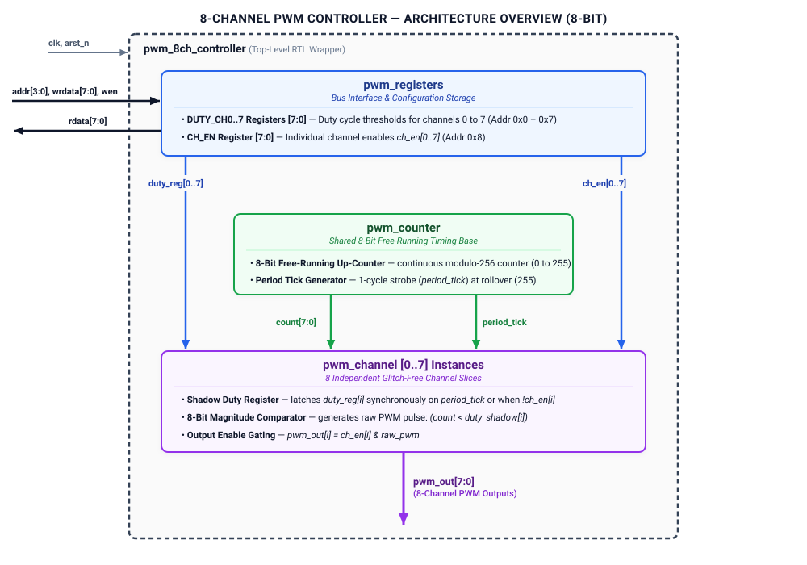
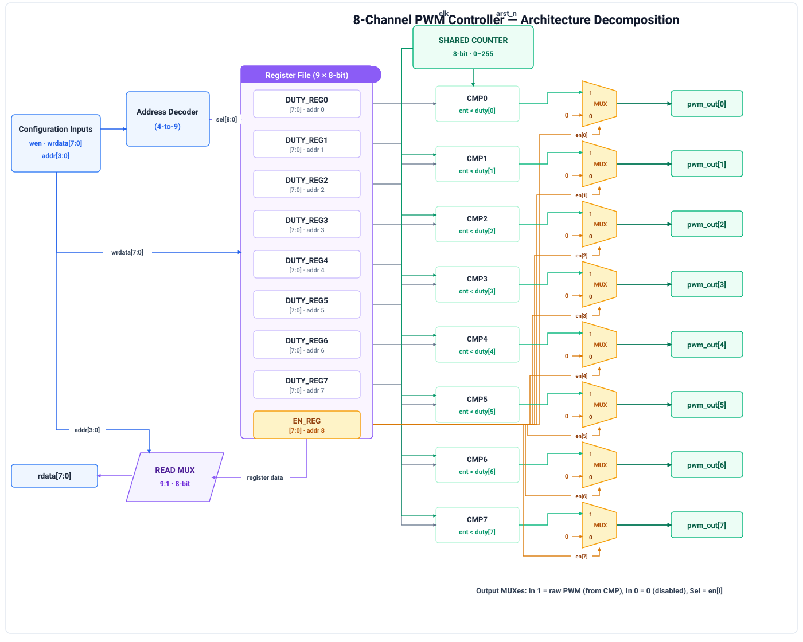

# 8-Channel PWM Controller

**Architectural & Functional Specification Proposal**

**Author:** Adnan Bhai's Group  
**Module Name:** `pwm_8ch_controller`

---

## 1. Project Overview

The **`pwm_8ch_controller`** is a synthesizable, register-configured 8-channel Pulse-Width Modulation (PWM) controller core designed in SystemVerilog. The controller produces 8 independent digital PWM outputs (`pwm_out[7:0]`) synchronized to a common base frequency reference counter.

Configuration and control are managed through a standard 8-bit synchronous memory-mapped register bus (`addr`, `wrdata`, `wen`, `rdata`). Each channel provides an independent 8-bit duty-cycle register supporting 256 discrete duty-cycle quantization steps ($0/256$ to $255/256$).

### Key Features:

- **8 Independent PWM Channels:** Channels `CH0` through `CH7` feature dedicated 8-bit duty-cycle registers and individual channel enable controls.
- **8-Bit Data Bus Width:** Uniform 8-bit write (`wrdata[7:0]`) and read (`rdata[7:0]`) data paths across all registers.
- **8-Bit Duty-Cycle Resolution (0–255):** 256 discrete levels per channel; $0$ produces a continuous `LOW` (0.00% duty), while $255$ yields $99.61\%$ duty cycle ($255/256$).
- **Compact 9-Register Map:** Exactly 9 registers total (Addresses `0x0` through `0x8`).
- **Individual Channel Enables (No Separate Global Enable):** Address `0x8` maps the 8 channel enable bits (`ch_en[7:0]`), eliminating redundant global enable registers or bits.
- **Unified Base Frequency:** Single shared 8-bit timing reference counter ensures all active channels switch at the exact same PWM carrier frequency and maintain synchronous period alignment.
- **Glitch-Free Dynamic Duty Updates:** Internal shadow registers latch updated duty thresholds only at PWM period boundaries (`period_tick`) or while the channel is disabled.
- **Asynchronous Active-Low Reset (`arst_n`):** Immediate hardware initialization clearing all registers, counters, shadow latches, and forcing `pwm_out[7:0]` to `0`.

---

## 2. Parameter Specifications

| Parameter      | Type  | Default / Scope | Description                                                                             |
| :------------- | :---: | :-------------: | :-------------------------------------------------------------------------------------- |
| `NUM_CHANNELS` | `int` |       `8`       | Number of independent PWM output channels (`CH0`–`CH7`).                                |
| `ADDR_WIDTH`   | `int` |       `4`       | Width of the register address bus (`addr[3:0]`), supporting up to 16 address locations. |
| `DATA_WIDTH`   | `int` |       `8`       | Configuration and readback bus data width (`wrdata[7:0]`, `rdata[7:0]`).                |
| `RESOLUTION`   | `int` |       `8`       | Bit-resolution of the PWM duty-cycle and timing reference counter ($2^8 = 256$ steps).  |
| `COUNTER_MAX`  | `int` |      `255`      | Maximum terminal count value for the base counter ($2^{\text{RESOLUTION}} - 1$).        |

---

## 3. Top-Level Module Interface (`pwm_8ch_controller`)

### 3.1 Top-Level Pinout Diagram


### 3.2 Pin Descriptions

| Port Name | Direction | Width |    Domain    | Description & Functionality                                                                                                          |
| :-------- | :-------: | :---: | :----------: | :----------------------------------------------------------------------------------------------------------------------------------- |
| `clk`     |   Input   |  `1`  |    `clk`     | **System Clock:** Master clock reference driving register updates, counters, and output sampling.                                    |
| `arst_n`  |   Input   |  `1`  | Asynchronous | **Hardware Reset:** Active-low asynchronous reset. Resets all registers, counters, shadow latches, and forces `pwm_out[7:0]` to `0`. |
| `addr`    |   Input   |  `4`  |    `clk`     | **Register Address:** Target register address (`4'h0` through `4'h8`). Synchronous to `clk`.                                         |
| `wrdata`  |   Input   |  `8`  |    `clk`     | **Write Data:** 8-bit input data payload written into the selected register when `wen = 1`.                                          |
| `wen`     |   Input   |  `1`  |    `clk`     | **Write Enable:** Active-high synchronous strobe indicating a valid write operation.                                                 |
| `rdata`   |  Output   |  `8`  |    `clk`     | **Read Data:** 8-bit output data bus reflecting the decoded contents of register `addr` (continuous combinational readback).         |
| `pwm_out` |  Output   |  `8`  |    `clk`     | **PWM Outputs:** 8-bit output bus (`pwm_out[7:0]`) delivering generated pulse waveforms for channels 0 to 7.                         |

---

## 4. Register Map (9 Registers Total)

The controller contains exactly 9 memory-mapped 8-bit registers decoded from `addr[3:0]`:

| Address | Register Name | Access | Reset Value | Bit [7:0] Description                                              |
| :-----: | :------------ | :----: | :---------: | :----------------------------------------------------------------- |
| `0x0`   | `DUTY_CH0`    |  R/W   |   `8'h00`   | Channel 0 Duty Cycle Threshold ($0$–$255$).                        |
| `0x1`   | `DUTY_CH1`    |  R/W   |   `8'h00`   | Channel 1 Duty Cycle Threshold ($0$–$255$).                        |
| `0x2`   | `DUTY_CH2`    |  R/W   |   `8'h00`   | Channel 2 Duty Cycle Threshold ($0$–$255$).                        |
| `0x3`   | `DUTY_CH3`    |  R/W   |   `8'h00`   | Channel 3 Duty Cycle Threshold ($0$–$255$).                        |
| `0x4`   | `DUTY_CH4`    |  R/W   |   `8'h00`   | Channel 4 Duty Cycle Threshold ($0$–$255$).                        |
| `0x5`   | `DUTY_CH5`    |  R/W   |   `8'h00`   | Channel 5 Duty Cycle Threshold ($0$–$255$).                        |
| `0x6`   | `DUTY_CH6`    |  R/W   |   `8'h00`   | Channel 6 Duty Cycle Threshold ($0$–$255$).                        |
| `0x7`   | `DUTY_CH7`    |  R/W   |   `8'h00`   | Channel 7 Duty Cycle Threshold ($0$–$255$).                        |
| `0x8`   | `CH_EN`       |  R/W   |   `8'h00`   | Individual Channel Enables: Bit $i$ enables Channel $i$ (`0`–`7`). |
| `0x9–F` | `RESERVED`    |   RO   |   `8'h00`   | Unmapped space returns `8'h00` on read; writes ignored.            |

> [!NOTE]
> There is **no separate global enable register**. Each channel output is individually qualified and gated by its corresponding bit in the `CH_EN` register (`pwm_out[i] = ch_en[i] & raw_pwm`).

---

## 5. Architecture & Submodule Decomposition

The top-level module `pwm_8ch_controller` decomposes into modular, high-cohesion submodules separating bus decoding, timing generation, and per-channel pulse synthesis:



### Submodule Descriptions

1. **`pwm_registers` (Register Bank & Address Decoder):**  
   Decodes the 4-bit synchronous bus address `addr[3:0]`. Handles write access (`wen`) and continuous readback of the 8 channel duty-cycle registers (`DUTY_CH0`–`DUTY_CH7`) and the channel enable register (`CH_EN`).
2. **`pwm_counter` (Shared 8-Bit Timing Reference):**  
   Maintains a common 8-bit free-running up-counter (`counter[7:0]`, counting `0` to `255`). Increments on every active clock edge and rolls over to `0` upon reaching `255`. It asserts a single-cycle strobe (`period_tick`) at rollover to mark the boundary of each PWM period across all channels.
3. **`pwm_channel` (Per-Channel Pulse Generator):**  
   Instantiated 8 times (`gen_channel[0]` through `gen_channel[7]`). Each instance encapsulates:
   - A **Shadow Duty Register** that latches new duty configuration when `period_tick = 1` or when the channel is disabled (`!ch_en[i]`).
   - An **8-Bit Magnitude Comparator** that asserts raw pulse when `counter < duty_shadow`.
   - **Output Gating Logic** that enforces zero output whenever the channel is disabled (`ch_en[i] == 0`).

---

## 6. RTL Microarchitecture

The synthesizable register-transfer level (RTL) microarchitecture decomposes the design into functional logic blocks, registers, multiplexers, and inter-module signal highways:



### Microarchitectural Components

1. **Address Decoder & Bus Interface:**
   - **4-to-9 Address Decoder:** Decodes `addr[3:0]` qualified by `wen` to assert one of 9 individual register write enables `sel[8:0]`.
   - **Write Data Bus:** Distributes input data `wrdata[7:0]` to the target register selected by `sel[8:0]`.
   - **READ MUX (9:1 · 8-bit):** Combinational multiplexer decoding `addr[3:0]` to continuously output the selected register value onto `rdata[7:0]`.

2. **Register File (9 × 8-Bit Registers):**
   - **DUTY Registers (0x0–0x7):** 8 banks of 8-bit registers (`DUTY_REG0` through `DUTY_REG7`) storing per-channel duty thresholds ($0$–$255$).
   - **Channel Enable Register EN_REG (0x8):** 8-bit register holding individual channel enable bits `en[7:0]`.

3. **Shared 8-Bit Timing Counter:**
   - **Reference Counter:** Synchronous modulo-256 up-counter (`0` to `255`) clocked by master clock `clk` with active-low asynchronous reset `arst_n`.
   - **Count Distribution:** Broadcasts the shared reference count `cnt[7:0]` to all 8 comparator slices in parallel, ensuring identical PWM carrier frequencies across all active channels.

4. **8 Parallel Comparators (CMP0–CMP7):**
   - Each channel slice evaluates the unsigned comparison `cnt < duty[i]`.
   - Generates an active-high raw pulse waveform `raw_pwm[i]` with duty cycle proportional to `duty[i]/256`.

5. **Output Multiplexers (MUX0–MUX7):**
   - 2:1 multiplexer per channel controlled by select bit `en[i]` from `EN_REG`.
   - **Input 1:** Connected to raw PWM pulse from comparator `CMP[i]`.
   - **Input 0:** Tied to constant Logic `0` (disabled state).
   - Delivers clean, glitch-free output pulses onto `pwm_out[0]` through `pwm_out[7]`.

---

## 7. Design Notes

1. **Reset Strategy:**  
   The design employs an active-low asynchronous reset (`arst_n`). All internal flip-flops (registers, counters, shadow latches) deterministically reset to `0`. Downstream systems observe steady `LOW` outputs during assertion of reset. De-assertion should be synchronized externally to `clk` to prevent reset-recovery race hazards.
2. **Duty-Cycle Quantization & Boundary Conditions:**  
   The 8-bit duty resolution yields 256 discrete duty steps:
   - **$D = 0$ (0.00%):** Comparator condition `(counter < 8'd0)` is identically false; output stays continuously `0`.
   - **$D = 64$ (25.00%):** Output is `HIGH` for 64 clock cycles ($0 \le \text{count} \le 63$), `LOW` for 192 clock cycles ($64 \le \text{count} \le 255$).
   - **$D = 128$ (50.00%):** Output is `HIGH` for 128 clock cycles, `LOW` for 128 clock cycles.
   - **$D = 255$ (99.61%):** Output is `HIGH` for 255 clock cycles ($0 \le \text{count} \le 254$), `LOW` for 1 clock cycle ($\text{count} = 255$).
3. **PWM Output Frequency Calculation:**  
   Given input clock frequency $f_{\text{clk}}$, the PWM switching frequency $f_{\text{pwm}}$ is:
   $$f_{\text{pwm}} = \frac{f_{\text{clk}}}{256}$$
   - At $f_{\text{clk}} = 50\text{ MHz}$, $f_{\text{pwm}} \approx 195.31\text{ kHz}$.
   - At $f_{\text{clk}} = 25\text{ MHz}$, $f_{\text{pwm}} \approx 97.65\text{ kHz}$.
   - At $f_{\text{clk}} = 10\text{ MHz}$, $f_{\text{pwm}} \approx 39.06\text{ kHz}$.
4. **Glitch Immunity:**  
   Because the comparator evaluates against `duty_shadow` rather than directly against `duty_reg`, dynamic register writes at any random cycle within a period are safe and cannot cause pulse truncation or glitches.

---

## 8. Simulation & Build Guide

The design is verified using the project's root `Makefile` with the AMD Vivado Simulator toolchain (`xvlog`, `xelab`, `xsim`).

### Compilation & Simulation Commands

```bash
# Run default testbench with a clean build
make all

# Explicitly specify top-level testbench module
make all TOP=tb_pwm_8ch_controller

# Fast incremental run without cleaning
make run TOP=tb_pwm_8ch_controller

# Launch interactive GUI waveform viewer
make gui TOP=tb_pwm_8ch_controller

# Clean build artifacts and simulation logs
make clean
```
