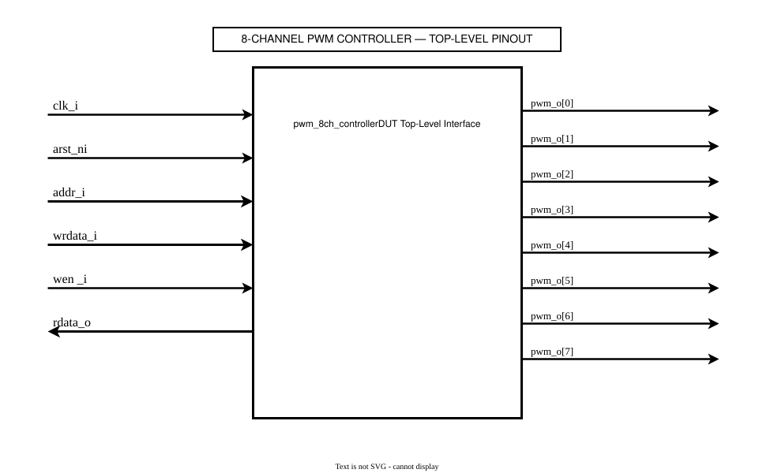
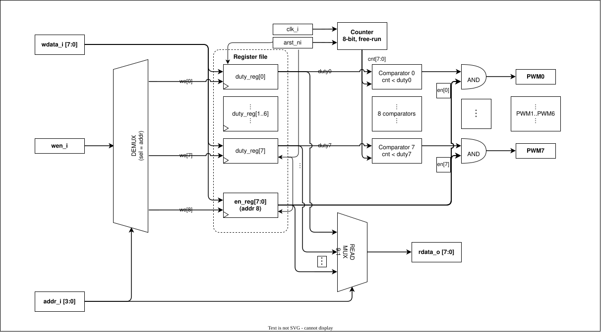

# 8-Channel PWM Controller

**Architectural & Functional Specification Proposal**

**Author:** Adnan Bhai's Group  
**Module Name:** `pwm_8ch_controller`

---

## 1. Project Overview

The **`pwm_8ch_controller`** is a synthesizable, register-configured 8-channel Pulse-Width Modulation (PWM) controller core designed in SystemVerilog. The controller produces 8 independent digital PWM outputs (`PWM0` through `PWM7` / `pwm_o[7:0]`) synchronized to a common base frequency reference counter.

Configuration and control are managed through an 8-bit synchronous memory-mapped register bus (`addr_i`, `wdata_i`, `wen_i`, `rdata_o`). Each channel provides an independent 8-bit duty-cycle register supporting 256 discrete duty-cycle quantization steps ($0/256$ to $255/256$).

### Key Features:

- **8 Independent PWM Channels:** Channels `PWM0` through `PWM7` feature dedicated 8-bit duty-cycle registers (`duty_reg[0]` through `duty_reg[7]`) and individual channel enable controls (`en[0]` through `en[7]`).
- **8-Bit Data Bus Width:** Uniform 8-bit write (`wdata_i[7:0]`) and read (`rdata_o[7:0]`) data paths across all registers.
- **8-Bit Duty-Cycle Resolution (0–255):** 256 discrete levels per channel; $0$ produces a continuous `LOW` (0.00% duty), while $255$ yields $99.61\%$ duty cycle ($255/256$).
- **Compact 9-Register Map:** Exactly 9 registers total (Addresses `0x0` through `0x8`).
- **Individual Channel Enables:** Address `0x8` maps the 8 channel enable bits (`en_reg[7:0]`), eliminating redundant global enable registers.
- **Unified Base Frequency:** Single shared 8-bit free-running timing reference counter (`cnt[7:0]`) ensures all active channels switch at the exact same PWM carrier frequency and maintain synchronous period alignment.
- **Direct Dynamic Duty Updates:** Duty registers directly feed the parallel magnitude comparators (`cnt < duty[i]`), updating pulse widths dynamically upon register write.
- **Output Enable Gating:** Dedicated 2-input AND gates qualify each comparator output with its corresponding channel enable bit (`en[i]`) to drive `PWM0`..`PWM7` (`pwm_o[7:0]`).
- **Clock & Reset:** System clock input `clk_i` and asynchronous active-low reset `arst_ni`.

---

## 2. Parameter Specifications

| Parameter      | Type  | Default / Scope | Description                                                                               |
| :------------- | :---: | :-------------: | :---------------------------------------------------------------------------------------- |
| `NUM_CHANNELS` | `int` |       `8`       | Number of independent PWM output channels (`PWM0`–`PWM7`).                                |
| `ADDR_WIDTH`   | `int` |       `4`       | Width of the register address bus (`addr_i[3:0]`), supporting up to 16 address locations. |
| `DATA_WIDTH`   | `int` |       `8`       | Configuration and readback bus data width (`wdata_i[7:0]`, `rdata_o[7:0]`).               |
| `RESOLUTION`   | `int` |       `8`       | Bit-resolution of the PWM duty-cycle and timing reference counter ($2^8 = 256$ steps).    |
| `COUNTER_MAX`  | `int` |      `255`      | Maximum terminal count value for the base counter ($2^{\text{RESOLUTION}} - 1$).          |

---

## 3. Top-Level Module Interface (`pwm_8ch_controller`)

### 3.1 Top-Level Pinout Diagram



### 3.2 Pin Descriptions

| Port Name  | Direction | Width |    Domain    | Description & Functionality                                                                                                            |
| :--------- | :-------: | :---: | :----------: | :------------------------------------------------------------------------------------------------------------------------------------- |
| `clk_i`    |   Input   |  `1`  |   `clk_i`    | **System Clock:** Master clock reference driving register updates, timing counter, and output generation.                              |
| `arst_ni`  |   Input   |  `1`  | Asynchronous | **Hardware Reset:** Active-low asynchronous reset. Resets all internal registers, counter, and forces PWM outputs to `0`.             |
| `addr_i`   |   Input   |  `4`  |   `clk_i`    | **Register Address:** Target register address (`4'h0` through `4'h8`). Synchronous to `clk_i`.                                         |
| `wdata_i`  |   Input   |  `8`  |   `clk_i`    | **Write Data:** 8-bit input data payload written into selected register when `wen_i = 1`.                                             |
| `wen_i`    |   Input   |  `1`  |   `clk_i`    | **Write Enable:** Synchronous strobe indicating a valid write operation.                                                               |
| `rdata_o`  |  Output   |  `8`  |   `clk_i`    | **Read Data:** 8-bit output data bus from 9:1 READ MUX reflecting selected register contents (`addr_i`).                               |
| `pwm_o`    |  Output   |  `8`  |   `clk_i`    | **PWM Outputs:** 8-channel PWM pulse outputs (`PWM0` through `PWM7` / `pwm_o[7:0]`).                                                   |

---

## 4. Register Map (9 Registers Total)

The controller contains exactly 9 memory-mapped 8-bit registers decoded from `addr_i[3:0]`:

| Address | Register Name  | Access | Reset Value | Bit [7:0] Description                                              |
| :-----: | :------------- | :----: | :---------: | :----------------------------------------------------------------- |
| `0x0`   | `duty_reg[0]`  |  R/W   |   `8'h00`   | Channel 0 Duty Cycle Threshold ($0$–$255$).                        |
| `0x1`   | `duty_reg[1]`  |  R/W   |   `8'h00`   | Channel 1 Duty Cycle Threshold ($0$–$255$).                        |
| `0x2`   | `duty_reg[2]`  |  R/W   |   `8'h00`   | Channel 2 Duty Cycle Threshold ($0$–$255$).                        |
| `0x3`   | `duty_reg[3]`  |  R/W   |   `8'h00`   | Channel 3 Duty Cycle Threshold ($0$–$255$).                        |
| `0x4`   | `duty_reg[4]`  |  R/W   |   `8'h00`   | Channel 4 Duty Cycle Threshold ($0$–$255$).                        |
| `0x5`   | `duty_reg[5]`  |  R/W   |   `8'h00`   | Channel 5 Duty Cycle Threshold ($0$–$255$).                        |
| `0x6`   | `duty_reg[6]`  |  R/W   |   `8'h00`   | Channel 6 Duty Cycle Threshold ($0$–$255$).                        |
| `0x7`   | `duty_reg[7]`  |  R/W   |   `8'h00`   | Channel 7 Duty Cycle Threshold ($0$–$255$).                        |
| `0x8`   | `en_reg[7:0]`  |  R/W   |   `8'h00`   | Individual Channel Enables: Bit $i$ enables Channel $i$ (`0$–$7$). |
| `0x9–F` | `RESERVED`     |   RO   |   `8'h00`   | Unmapped space returns `8'h00` on read; writes ignored.            |

> [!NOTE]
> There is **no separate global enable register**. Each channel output is individually qualified by its corresponding bit in `en_reg[7:0]` using a 2-input AND gate:
> $$\text{PWM}[i] = \text{en}[i] \ \& \ (\text{cnt}[7:0] < \text{duty}[i])$$

---

## 5. RTL Microarchitecture

The synthesizable register-transfer level (RTL) microarchitecture decomposes the design into two functional submodules under the top-level `pwm_8ch_controller`:
- **`pwm_registers` (`u_registers`):** Synchronous register file, bus address decoder, and 9:1 readback multiplexer.
- **`pwm_generator` (`u_generator`):** PWM datapath generator integrating the shared free-running timing reference counter, 8 parallel magnitude comparators, and output enable gating.



### Microarchitectural Components

1. **Write Address Demultiplexer & Bus Interface (`DEMUX` in `pwm_registers`):**
   - **DEMUX (`sel = addr_i`):** Decodes `addr_i[3:0]` to route `wen_i` to individual write strobes `we[0..7]` (duty registers) and `we[8]` (`en_reg`).
   - **Write Data Bus (`wdata_i[7:0]`):** Broadcasts data in parallel to `duty_reg[0..7]` and `en_reg[7:0]`.
   - **READ MUX (9:1):** Decodes `addr_i[3:0]` to continuously route the selected register onto `rdata_o[7:0]`.

2. **Register File (9 × 8-Bit Registers):**
   - **Duty Registers (`duty_reg[0..7]` at `0x0..0x7`):** 8 registers storing duty thresholds ($0$–$255$), feeding comparators directly as `duty0..duty7`.
   - **Channel Enable Register (`en_reg[7:0]` at `0x8`):** Holds individual channel enables `en[0..7]`.
   - Deterministically reset to `8'h00` via asynchronous `arst_ni`; updated synchronously on `clk_i` rising edge when `we[i] = 1`.

3. **Shared 8-Bit Free-Running Timing Counter:**
   - Modulo-256 up-counter (`0` to `255`) clocked by `clk_i` with asynchronous active-low reset `arst_ni`.
   - Broadcasts `cnt[7:0]` to all 8 comparators in parallel, ensuring identical carrier frequency and phase alignment.

4. **8 Parallel Magnitude Comparators (Comparator 0 – Comparator 7):**
   - Evaluates $\text{cmp\_out}[i] = (\text{cnt}[7:0] < \text{duty}[i])$.
   - Generates raw active-high PWM pulses proportional to $\text{duty}[i]/256$.

5. **Output Enable Gating Logic (AND Gates):**
   - Combines raw pulse with enable bit: $\text{PWM}i = \text{cmp\_out}[i] \ \& \ \text{en}[i]$.
   - Forces output to `0` when disabled ($\text{en}[i] = 0$); drives `PWM0..PWM7` (`pwm_o[7:0]`) when enabled.

---

## 6. Design Notes

1. **Reset Strategy:**  
   Asynchronous active-low reset `arst_ni` clears all registers and the counter to `0`, forcing all PWM outputs to steady `LOW`. Synchronize de-assertion to `clk_i` externally.
2. **Duty-Cycle Quantization & Boundary Conditions:**  
   Provides 256 discrete duty levels ($0/256$ to $255/256$):
   - **$D = 0$ (0.00%):** `cnt < 8'd0` is identically false; output remains continuous `LOW`.
   - **$D = 64$ (25.00%):** `HIGH` for 64 cycles ($0 \le \text{cnt} \le 63$), `LOW` for 192 cycles.
   - **$D = 128$ (50.00%):** `HIGH` for 128 cycles, `LOW` for 128 cycles.
   - **$D = 255$ (99.61%):** `HIGH` for 255 cycles ($0 \le \text{cnt} \le 254$), `LOW` for 1 cycle ($\text{cnt} = 255$).

   > [!NOTE]
   > **100.00% Duty Cycle (Architectural Specification & DV Guideline):**  
   > In this standard 8-bit unsigned quantization scheme (`cnt < duty` with modulo-256 counter), the valid duty range is strictly $0/256$ ($0.00\%$) to $255/256$ ($99.61\%$). Continuous DC $100.00\%$ is architecturally not supported in this mode and is **by design (as-specified)**, not an RTL defect. Verification teams must verify $D = 255$ as strictly 255 active-high clock cycles out of 256 per PWM period. If continuous DC $100.00\%$ is required by application software, it should be handled via external bypass/GPIO override.
3. **PWM Output Frequency Calculation:**  
   $$f_{\text{pwm}} = \frac{f_{\text{clk\_i}}}{256}$$
   - At $f_{\text{clk\_i}} = 50\text{ MHz}$, $f_{\text{pwm}} \approx 195.31\text{ kHz}$.
   - At $f_{\text{clk\_i}} = 25\text{ MHz}$, $f_{\text{pwm}} \approx 97.65\text{ kHz}$.
   - At $f_{\text{clk\_i}} = 10\text{ MHz}$, $f_{\text{pwm}} \approx 39.06\text{ kHz}$.
4. **Dynamic Duty Updates:**  
   Duty registers feed comparators directly; updates take effect immediately upon register write.

---

## 7. Simulation & Build Guide

The design is verified using the project's root `Makefile` with the AMD Vivado Simulator toolchain (`xvlog`, `xelab`, `xsim`).

### Compilation & Simulation Commands

```bash
# Run default testbench with a clean build
make all

# Explicitly specify top-level testbench module
make all TOP=tb_pwm_8ch_controller

# Fast incremental run without cleaning
make run TOP=tb_pwm_8ch_controller

# Clean build artifacts and simulation logs
make clean
```
