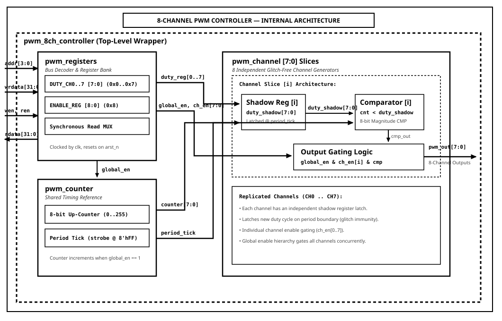

# 8-Channel PWM Controller

**Architectural & Functional Specification Proposal**

**Author:** Adnan Bhai's Group  
**Module Name:** `pwm_8ch_controller`

---

## 1. Project Overview

The **`pwm_8ch_controller`** is a synthesizable, register-configured 8-channel Pulse-Width Modulation (PWM) controller core designed in SystemVerilog. The controller produces 8 independent digital PWM outputs (`pwm_out[7:0]`) synchronized to a common base frequency reference counter.

Configuration and control are managed through a standard 32-bit synchronous memory-mapped register bus (`addr`, `wrdata`, `wen`, `ren`, `rdata`). Each channel provides an independent 8-bit duty-cycle register supporting 256 discrete duty-cycle quantization steps ($0/256$ to $255/256$).

### Key Features:

- **8 Independent PWM Channels:** Channels `CH0` through `CH7` feature dedicated duty-cycle registers and enable controls.
- **8-Bit Duty-Cycle Resolution:** 256 discrete levels ($0$ to $255$) per channel; $0$ produces a continuous `LOW` (0.00% duty), while $255$ yields $99.61\%$ duty cycle.
- **Two-Tier Enable Hierarchy:** Master `GLOBAL_EN` bit controls the shared counter and gates all outputs; individual `CHx_EN` bits enable targeted channel activation.
- **Synchronous 32-bit Bus Interface:** Clean, single-cycle write and read operations for register configuration and status query.
- **Asynchronous Active-Low Reset (`arst_n`):** Immediate, deterministic hardware initialization of all registers, state elements, and output pads to zero.

---

## 2. Parameter Specifications

| Parameter      | Type  | Default / Scope | Description                                                                             |
| :------------- | :---: | :-------------: | :-------------------------------------------------------------------------------------- |
| `NUM_CHANNELS` | `int` |       `8`       | Number of independent PWM output channels (`CH0`–`CH7`).                                |
| `ADDR_WIDTH`   | `int` |       `4`       | Width of the register address bus (`addr[3:0]`), supporting up to 16 address locations. |
| `DATA_WIDTH`   | `int` |      `32`       | Configuration and readback bus data width (`wrdata[31:0]`, `rdata[31:0]`).              |
| `RESOLUTION`   | `int` |       `8`       | Bit-resolution of the PWM duty-cycle and timing reference counter ($2^8 = 256$ steps).  |
| `COUNTER_MAX`  | `int` |      `255`      | Maximum terminal count value for the base counter ($2^{\text{RESOLUTION}} - 1$).        |

---

## 3. Top-Level Module Interface (`pwm_8ch_controller`)

### 3.1 Top-Level Pinout Diagram


### 3.2 Pin Descriptions

| Port Name | Direction | Width |    Domain    | Description & Functionality                                                                                                          |
| :-------- | :-------: | :---: | :----------: | :----------------------------------------------------------------------------------------------------------------------------------- |
| `clk`     |   Input   |  `1`  |    `clk`     | **System Clock:** Master clock reference driving register updates, counters, and output sampling.                                    |
| `arst_n`  |   Input   |  `1`  | Asynchronous | **Hardware Reset:** Active-low asynchronous reset. Resets all registers, counters, shadow latches, and forces `pwm_out[7:0]` to `0`. |
| `addr`    |   Input   |  `4`  |    `clk`     | **Register Address:** Target register address (`4'h0` through `4'h8`). Synchronous to `clk`.                                         |
| `wrdata`  |   Input   | `32`  |    `clk`     | **Write Data:** 32-bit input data payload written into the selected register when `wen = 1`.                                         |
| `wen`     |   Input   |  `1`  |    `clk`     | **Write Enable:** Active-high synchronous strobe indicating a valid write operation.                                                 |
| `ren`     |   Input   |  `1`  |    `clk`     | **Read Enable:** Active-high synchronous strobe initiating register readback onto `rdata`.                                           |
| `rdata`   |  Output   | `32`  |    `clk`     | **Read Data:** 32-bit output data bus reflecting the contents of register `addr` during active read cycles.                          |
| `pwm_out` |  Output   |  `8`  |    `clk`     | **PWM Outputs:** 8-bit output bus (`pwm_out[7:0]`) delivering generated pulse waveforms for channels 0 to 7.                         |

---

## 4. Architecture & Submodule Decomposition

The top-level module `pwm_8ch_controller` decomposes into modular, high-cohesion submodules separating bus decoding, timing generation, and per-channel pulse synthesis:



### Submodule Descriptions

1. **`pwm_registers` (Register Bank & Address Decoder):**  
   Decodes the 4-bit synchronous bus address `addr[3:0]`. Handles write access (`wen`) and read access (`ren`) to the 8 channel duty-cycle registers (`DUTY_CH0`–`DUTY_CH7`) and the enable control register (`ENABLE_REG`). Drives configuration values to the channel slices.
2. **`pwm_counter` (Shared 8-Bit Timing Reference):**  
   Maintains a common 8-bit free-running up-counter (`0` to `255`). When `global_en` is asserted, the counter increments on each active clock edge and rolls over to `0` upon reaching `255`. It asserts a single-cycle strobe (`period_tick`) at rollover to mark the boundary of each PWM period.
3. **`pwm_channel` (Per-Channel Pulse Generator):**  
   Instantiated 8 times (`gen_channel[0]` through `gen_channel[7]`). Each instance encapsulates:
   - A **Shadow Duty Register** that latches new duty configuration only when `period_tick = 1`.
   - An **8-Bit Magnitude Comparator** that asserts raw pulse when `counter < duty_shadow`.
   - **Output Gating Logic** that enforces zero output unless both master `global_en` and channel `ch_en[i]` are asserted.

---

## 5. Domain-Specific Mechanisms

### 5.1 Register Address Map & Bit Allocation

The controller maps 9 memory-mapped registers accessible across addresses `4'h0` to `4'h8`:

| Address (`addr[3:0]`) | Register Name |  Width   | Access |  Reset Default  | Functional Purpose                         |
| :-------------------: | :------------ | :------: | :----: | :-------------: | :----------------------------------------- |
|      `4'h0` (0)       | `DUTY_CH0`    | `[7:0]`  |  R/W   | `32'h0000_0000` | Channel 0 duty-cycle value ($0$–$255$)     |
|      `4'h1` (1)       | `DUTY_CH1`    | `[7:0]`  |  R/W   | `32'h0000_0000` | Channel 1 duty-cycle value ($0$–$255$)     |
|      `4'h2` (2)       | `DUTY_CH2`    | `[7:0]`  |  R/W   | `32'h0000_0000` | Channel 2 duty-cycle value ($0$–$255$)     |
|      `4'h3` (3)       | `DUTY_CH3`    | `[7:0]`  |  R/W   | `32'h0000_0000` | Channel 3 duty-cycle value ($0$–$255$)     |
|      `4'h4` (4)       | `DUTY_CH4`    | `[7:0]`  |  R/W   | `32'h0000_0000` | Channel 4 duty-cycle value ($0$–$255$)     |
|      `4'h5` (5)       | `DUTY_CH5`    | `[7:0]`  |  R/W   | `32'h0000_0000` | Channel 5 duty-cycle value ($0$–$255$)     |
|      `4'h6` (6)       | `DUTY_CH6`    | `[7:0]`  |  R/W   | `32'h0000_0000` | Channel 6 duty-cycle value ($0$–$255$)     |
|      `4'h7` (7)       | `DUTY_CH7`    | `[7:0]`  |  R/W   | `32'h0000_0000` | Channel 7 duty-cycle value ($0$–$255$)     |
|      `4'h8` (8)       | `ENABLE_REG`  | `[8:0]`  |  R/W   | `32'h0000_0000` | Global enable & individual channel enables |
|     `4'h9`–`4'hF`     | _RESERVED_    | `[31:0]` |   R    | `32'h0000_0000` | Reserved; writes ignored, reads return 0   |

### 5.2 Enable Register Bit Allocation (`ENABLE_REG`)

```
 31                             9   8      7      6      5      4      3      2      1      0
┌────────────────────────────────┬──────┬──────┬──────┬──────┬──────┬──────┬──────┬──────┬──────┐
│            RESERVED            │ CH7  │ CH6  │ CH5  │ CH4  │ CH3  │ CH2  │ CH1  │ CH0  │ GLB  │
│          (Reads 0)             │  EN  │  EN  │  EN  │  EN  │  EN  │  EN  │  EN  │  EN  │  EN  │
└────────────────────────────────┴──────┴──────┴──────┴──────┴──────┴──────┴──────┴──────┴──────┘
```

- **Bit 0 (`GLOBAL_EN`):** Master enable for the entire controller. When `0`, the shared counter is held in reset (`0`) and all PWM outputs are held strictly `0`.
- **Bits 8:1 (`CH7_EN`..`CH0_EN`):** Individual channel output enables. Channel $i$ generates pulses if and only if `GLOBAL_EN == 1` and `ENABLE_REG[i+1] == 1`.

---

## 6. Design Notes

1. **Reset Strategy:**  
   The design employs an active-low asynchronous reset (`arst_n`). All internal flip-flops (registers, counters, shadow latches) deterministically reset to `0`. Downstream systems observe steady `LOW` outputs during assertion of reset. De-assertion should be synchronized externally to `clk` to prevent reset-recovery race hazards.
2. **Duty-Cycle Quantization & Boundary Conditions:**  
   The 8-bit duty resolution yields 256 discrete duty steps:
   - **$D = 0$ (0.00%):** Comparator condition `(duty_shadow != 8'h00)` guarantees output stays continuously `0` (never pulses HIGH for 1 clock cycle).
   - **$D = 64$ (25.00%):** Output is `HIGH` for 64 clock cycles ($0 \le \text{count} \le 63$), `LOW` for 192 clock cycles ($64 \le \text{count} \le 255$).
   - **$D = 128$ (50.00%):** Output is `HIGH` for 128 clock cycles, `LOW` for 128 clock cycles.
   - **$D = 255$ (99.61%):** Output is `HIGH` for 255 clock cycles ($0 \le \text{count} \le 254$), `LOW` for 1 clock cycle ($\text{count} = 255$).
3. **PWM Output Frequency Calculation:**  
   Given input clock frequency $f_{\text{clk}}$, the PWM switching frequency $f_{\text{pwm}}$ is:
   $$f_{\text{pwm}} = \frac{f_{\text{clk}}}{256}$$
   - At $f_{\text{clk}} = 50\text{ MHz}$, $f_{\text{pwm}} \approx 195.31\text{ kHz}$.
   - At $f_{\text{clk}} = 25\text{ MHz}$, $f_{\text{pwm}} \approx 97.65\text{ kHz}$.
   - At $f_{\text{clk}} = 10\text{ MHz}$, $f_{\text{pwm}} \approx 39.06\text{ kHz}$.
4. **Glitch Immunity:**  
   Because the comparator evaluates against `duty_shadow` rather than directly against `duty_reg`, dynamic register writes at any random cycle within a period are safe and cannot cause pulse truncation or glitches.

---

## 7. Simulation & Build Guide

The design is verified using the project's root `Makefile` with the AMD Vivado Simulator toolchain (`xvlog`, `xelab`, `xsim`).

### Compilation & Simulation Commands

```bash
# Run default testbench with a clean build
make all

# Explicitly specify top-level testbench module
make all TOP=tb_pwm_8ch_controller

# Fast incremental run without cleaning
make run TOP=tb_pwm_8ch_controller

# Launch interactive GUI waveform viewer
make gui TOP=tb_pwm_8ch_controller

# Clean build artifacts and simulation logs
make clean
```
